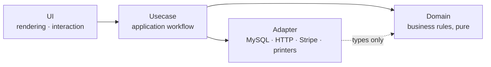

<h1 align="center">Mas Tomoda</h1>

  <b>English educator × product engineer</b> · Ibaraki, Japan 
  I turn everyday friction into working software, from classroom tools to a live subscription app, 
  and I build it with AI coding agents held to an architecture contract I wrote.

  <a href="https://masakuwa.jp/en/label-manager/"><b>Label Manager</b></a> ·
  <a href="https://masakuwa.jp/">masakuwa.jp</a> ·
  <a href="https://www.youtube.com/channel/UCmQWeIvgreL6BhQVXPp_5Sw">YouTube</a> ·
  <a href="https://x.com/MasaKuwaInsects">X @MasaKuwaInsects</a>

---

## What I bring

| | |
| --- | --- |
| 🧩 **Product engineering, end to end** | Product idea, architecture, payments, multilingual SEO, deployment and day-to-day operations, all on one live product. |
| 🤖 **Engineering with AI agents** | Machine-readable architecture rules, fail-loud validation gates and custom MCP servers that keep agent-written code correct. |
| 🔌 **Hardware and protocols** | Bluetooth thermal label printers integrated at the protocol level and verified with physical test prints. |
| 🎓 **Learning design** | Classroom software and AI prompts built on explicit models of how a lesson turns time into learning. |

---

## 🪲 Featured: MASAKUWA Insect Theater + Label Manager

**[masakuwa.jp](https://masakuwa.jp/)** is a site for stag- and rhinoceros-beetle breeders, and **[Label Manager](https://masakuwa.jp/en/label-manager/)** is its subscription web app. I designed, built and operate both.

- **The app:** individuals, bloodlines, pedigrees, care schedules, growth charts and yearly stats in one place. QR labels go to a Bluetooth label printer or to A4/Letter sheets, and the phone camera scans a label to open that individual.
- **Payments:** Stripe subscriptions. Free up to 50 individuals; monthly, 3-month and yearly Premium plans.
- **7 languages:** Japanese, English, Traditional and Simplified Chinese, Korean, French and German, with hreflang alternates, structured data and `llms.txt` for search engines and LLMs.
- **Hardware:** printer protocols for 5 thermal label printers (Marklife M1, P15 and X2, NIIMBOT D110_M, Phomemo D30). Each model is enabled only after physical test prints, and a print counts as done only when the printer confirms it.
- **Data:** a catalog of 5,400+ stag-beetle, rhinoceros-beetle and flower-chafer species and subspecies, with taxonomy audits against GBIF, plus local temperature forecasts from Japan Meteorological Agency data.
- **Operations:** a self-hosted Linux VPS running MySQL; releases ship as packages with a simulated schema migration first and live checks after.

  <code>1,400+ commits since March 2026</code>
  <code>3 apps: site · admin · Label Manager</code>
  <code>349 automated checks</code>
  <code>7 languages</code>

The source is private, but the product is live: **[try Label Manager for free →](https://masakuwa.jp/en/label-manager/)**

---

## 🤖 How I build with AI agents

AI agents write code fast. Rules and checks keep it correct. Every agent that works in my repository first reads a contract I wrote.

- **An architecture contract written for LLMs.** `AGENTS.md` is a compact rule language: four layers, one public gatekeeper file per module, numbered responsibility bands, and one canonical owner for every business rule.
- **Fail-loud gates.** 349 checks live in one catalog and run from one command (`npm run check -- <selector>`): architecture, contracts, types, product behavior, browser flows and MySQL runtime. A check that can't verify something fails the build instead of passing quietly.
- **Custom MCP servers.** A refactoring server maps modules, audits dependency edges, finds cycles and plans file moves as dry runs. A writing server reviews long-form reports against a research-based rubric.
- **Evidence over assertion.** Changes ship with screenshots, runtime evidence or physical-device proofs, not "it should work".

Agents I work with: Claude Code and Codex.

---

## 🎓 Education × AI (public repos)

| Project | What it does | Built with |
| --- | --- | --- |
| [ClassMaster](https://github.com/mastomoda-1126/products/tree/main/ClassMaster) | All-in-one lesson app: annotated English texts with translations and audio, PDF handouts, attendance and QR links to AI tutors. | Python, layered architecture |
| [time_table_extractor](https://github.com/mastomoda-1126/time_table_extractor) | Turns the school's hard-to-read timetable spreadsheet into a personal PDF for each teacher, and shows who is free in any period. | Python, Tkinter, openpyxl, ReportLab, PyInstaller |
| [promptfeeder](https://github.com/mastomoda-1126/promptfeeder) | Prompt portal: pick a prompt from a Google Sheet, copy it or download it as YAML, then jump to ChatGPT or Gemini. | Google Apps Script, HTML/JS |
| [dx_panic_loop_simulator](https://github.com/mastomoda-1126/dx_panic_loop_simulator) | Satire: a "digital transformation" with no data model, no owner and no roadmap. It always ends in "just print it". | Python |

---

## 🧠 Ideas I work from

- **T = B + E + P.** A lesson splits into board work and setup (B), explanation (E) and practice (P). Good tools shrink the overhead in B so more of the lesson goes to E and P.
- **L = R × h.** Learning is rate × hours. Structure and fast feedback raise the rate; portable AI prompts let students add hours on their own.
- **Structure first.** Find the structural bottleneck before adding features.
- **Human-first automation.** A tool earns its place only by cutting someone's time or cognitive load. Pushing extra input work onto people is a cost, not progress.

The longer version (in Japanese): **[career spellbook](https://github.com/mastomoda-1126/README/blob/main/Mas_career_spellbook.md)**

---

## 🛠️ Toolbox

---

<b>日本語プロフィール</b>

 

**英語教員 × プロダクトエンジニア（茨城）**

現場で感じた不便をソフトウェアで解決しています。AI コーディングエージェントを、自分で書いたアーキテクチャ契約と検証ゲートで統制して開発しています。

- **[MASAKUWA昆虫劇場](https://masakuwa.jp/) と [ラベルマネージャー](https://masakuwa.jp/label-manager/)**：クワガタ・カブトムシの飼育管理アプリと情報サイトを企画・設計・開発・運用しています。Stripe サブスク、7 言語対応、Bluetooth ラベルプリンター 5 機種対応（実機での印刷確認済み）、QR ラベル印刷とカメラでの読み取りに対応しています。
- **AI エージェント開発**：4 層アーキテクチャの契約（`AGENTS.md`）、349 件の自動チェック、自作の MCP サーバー（リファクタリング支援・レポート校閲）を使っています。
- **教育 × AI**：授業モデル T = B + E + P と L = R × h に基づいて、教員向けツール（ClassMaster、時間割抽出ツール、プロンプトフィーダー）を作っています。

