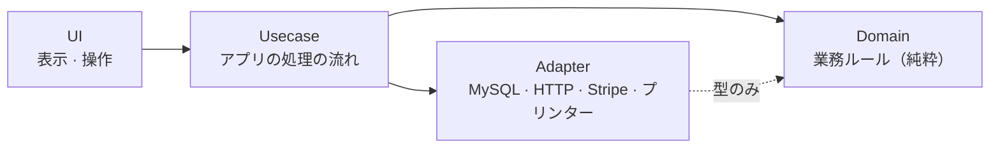

<h1 align="center">Mas Tomoda</h1>

  <a href="#日本語"><b>日本語</b></a> · <a href="#english"><b>English</b></a>

  <a href="https://masakuwa.jp/label-manager/"><b>ラベルマネージャー / Label Manager</b></a> ·
  <a href="https://masakuwa.jp/">masakuwa.jp</a> ·
  <a href="https://www.youtube.com/channel/UCmQWeIvgreL6BhQVXPp_5Sw">YouTube</a> ·
  <a href="https://youtu.be/d2XCikN_Fug?si=YhQVCJvEHL3kDK8k">ヤマコレ！深山ダンディズム</a> ·
  <a href="https://x.com/MasaKuwaInsects">X @MasaKuwaInsects</a>

---

## 日本語

**英語教員 × プロダクトエンジニア**（茨城）

日々の不便を、動くソフトウェアに変えています。授業で使うツールから、運用中のサブスクアプリまで。
AI コーディングエージェントを、自分で書いたアーキテクチャ契約で統制しながら開発しています。

### できること

| | |
| --- | --- |
| 🧩 **企画から運用までひとりで** | 運用中のプロダクトひとつで、企画・設計・決済・多言語 SEO・デプロイ・日々の運用まで担当しています。 |
| 🤖 **AI エージェントとの開発** | 機械が読めるアーキテクチャ規則、確かめられなければ失敗させる検証ゲート、自作の MCP サーバーで、エージェントが書くコードの正しさを保っています。 |
| 🔌 **ハードウェアとプロトコル** | Bluetooth のサーマルラベルプリンターをプロトコルのレベルで組み込み、実機での試し印刷で確かめています。 |
| 🎓 **学びの設計** | 授業の時間がどう学びに変わるかのモデルをもとに、授業用のソフトと AI プロンプトを作っています。 |

### 🪲 MASAKUWA昆虫劇場 + ラベルマネージャー

**[masakuwa.jp](https://masakuwa.jp/)** はクワガタ・カブトムシのブリーダー向けのサイト、**[ラベルマネージャー](https://masakuwa.jp/label-manager/)** はそのサブスク型 Web アプリです。どちらも企画・設計・開発・運用をしています。

- **アプリ：** 個体・血統・血統図・飼育スケジュール・成長グラフ・年間の統計をひとつにまとめています。QR ラベルを Bluetooth ラベルプリンターか A4・レターの用紙に印刷でき、スマホのカメラでラベルを読むとその個体が開きます。出品文づくりと、温湿度の記録（Govee H5075 を登録し、Govee Home の CSV を取り込む）にも対応しています。
- **決済：** Stripe のサブスク。50 頭まで無料で、Premium は月額・3 か月・年額のプランです。
- **7 言語：** 日本語・英語・中国語（繁体字・簡体字）・韓国語・フランス語・ドイツ語。hreflang、構造化データ、検索エンジンと LLM 向けの `llms.txt` を備えています。
- **ハードウェア：** サーマルラベルプリンター 5 機種（Marklife M1・P15・X2、NIIMBOT D110_M、Phomemo D30）のプロトコルを実装しています。どの機種も実機で試し印刷をしてから有効にし、印刷はプリンターが完了を返したときだけ「完了」と数えます。
- **データ：** クワガタ・カブトムシ・ハナムグリの種と亜種 5,400 件以上のカタログ（Catalogue of Life をもとに、GBIF との照合で分類を監査）と、気象庁のデータを使った地域の気温予報。
- **運用：** MySQL を動かす自前の Linux VPS。リリースはパッケージで出し、事前にスキーマの移行を模擬して、出したあとに本番で確認します。

  <code>2026 年 3 月から 1,480 コミット以上</code>
  <code>3 つのアプリ：サイト · 管理画面 · ラベルマネージャー</code>
  <code>自動チェック 366 件</code>
  <code>7 言語</code>

ソースは非公開ですが、プロダクトは運用中です：**[ラベルマネージャーを無料で試す →](https://masakuwa.jp/label-manager/)**

### 🤖 AI エージェントとの作り方

AI エージェントはコードを速く書きます。正しさを保つのは規則とチェックです。私のリポジトリで作業するエージェントは、最初に私が書いた契約を読みます。

- **LLM 向けに書いたアーキテクチャ契約。** `AGENTS.md` はコンパクトな規則の言語です。4 つの層、モジュールごとに公開の窓口となるゲートキーパーファイルがひとつ、番号つきの責務の帯、そして業務ルールひとつにつき正式な持ち主がひとつ。
- **確かめられなければ失敗させるゲート。** 366 件のチェックをひとつのカタログに置き、ひとつのコマンド（`npm run check -- <selector>`）で実行します。対象はアーキテクチャ、契約、型、プロダクトの振る舞い、ブラウザでの操作、MySQL の実行時の動作です。確かめられないチェックは黙って通さず、ビルドを失敗させます。
- **自作の MCP サーバー。** リファクタリング用のサーバーは、モジュールの地図を作り、依存関係を監査し、循環を見つけ、ファイルの移動をドライランで計画します。文章用のサーバーは、長いレポートを研究にもとづくルーブリックで校閲します。
- **主張より証拠。** 変更にはスクリーンショット、実行時の記録、実機での確認をつけて出します。「動くはず」では出しません。

一緒に開発しているエージェント：Claude Code、Codex、GitHub Copilot。

### 🎸 AI × 創作

自宅の GPU 1 台（8 GB）で動く制作アプリ「Studio」を、ラベルマネージャーと同じアーキテクチャ契約で作っています。ローカルの LLM・画像生成・音声・作曲・動画づくりを家の端末から使え、Claude からは MCP で呼べます。[YouTube](https://www.youtube.com/channel/UCmQWeIvgreL6BhQVXPp_5Sw) の曲と MV は、作詞・作曲・編曲 Masakuwa です。

### 🎓 教育 × AI（公開リポジトリ）

| プロジェクト | 何をするか | 使った技術 |
| --- | --- | --- |
| [ClassMaster](https://github.com/mastomoda-1126/products/tree/main/ClassMaster) | 授業をまとめて回すアプリ。訳と音声つきの英文教材、PDF のプリント、出欠、AI チューターへの QR リンク。 | Python、レイヤードアーキテクチャ |
| [time_table_extractor](https://github.com/mastomoda-1126/time_table_extractor) | 学校の読みにくい時間割のエクセルを先生ごとの PDF に変え、どの時間に誰が空いているかも表示します。 | Python、Tkinter、openpyxl、ReportLab、PyInstaller |
| [promptfeeder](https://github.com/mastomoda-1126/promptfeeder) | プロンプトのポータル。Google スプレッドシートからプロンプトを選び、コピーするか YAML でダウンロードして、ChatGPT や Gemini に移ります。 | Google Apps Script、HTML/JS |

### 🧠 大事にしている考え方

- **T = B + E + P.** 授業の時間は、板書と準備（B）、説明（E）、演習（P）に分かれます。良いツールは B の手間を減らし、そのぶんを E と P に回します。
- **L = R × h.** 学習は「効率 × 時間」。構造と速いフィードバックで効率を上げ、持ち歩ける AI プロンプトで生徒が自分で時間を足せるようにします。
- **構造が先。** 機能を足す前に、構造のボトルネックを見つけます。
- **人が先の自動化。** ツールが役に立つのは、誰かの時間や頭の負担を減らすときだけです。人に余計な入力作業を押しつけるのは、進歩ではなくコストです。

---

## English

**English educator × product engineer** · Ibaraki, Japan

I turn everyday friction into working software, from classroom tools to a live subscription app,
and I build it with AI coding agents held to an architecture contract I wrote.

### What I bring

| | |
| --- | --- |
| 🧩 **Product engineering, end to end** | Product idea, architecture, payments, multilingual SEO, deployment and day-to-day operations, all on one live product. |
| 🤖 **Engineering with AI agents** | Machine-readable architecture rules, fail-loud validation gates and custom MCP servers that keep agent-written code correct. |
| 🔌 **Hardware and protocols** | Bluetooth thermal label printers integrated at the protocol level and verified with physical test prints. |
| 🎓 **Learning design** | Classroom software and AI prompts built on explicit models of how a lesson turns time into learning. |

### 🪲 Featured: MASAKUWA Insect Theater + Label Manager

**[masakuwa.jp](https://masakuwa.jp/en/)** is a site for stag- and rhinoceros-beetle breeders, and **[Label Manager](https://masakuwa.jp/en/label-manager/)** is its subscription web app. I designed, built and operate both.

- **The app:** individuals, bloodlines, pedigrees, care schedules, growth charts and yearly stats in one place. QR labels go to a Bluetooth label printer or to A4/Letter sheets, and the phone camera scans a label to open that individual. It also writes listing text and keeps temperature and humidity records (register a Govee H5075 and import its Govee Home CSV).
- **Payments:** Stripe subscriptions. Free up to 50 individuals; monthly, 3-month and annual Premium plans.
- **7 languages:** Japanese, English, Traditional and Simplified Chinese, Korean, French and German, with hreflang alternates, structured data and `llms.txt` for search engines and LLMs.
- **Hardware:** printer protocols for 5 thermal label printers (Marklife M1, P15 and X2, NIIMBOT D110_M, Phomemo D30). Each model is enabled only after physical test prints, and a print counts as done only when the printer confirms it.
- **Data:** a catalog of 5,400+ stag-beetle, rhinoceros-beetle and flower-chafer species and subspecies, built on the Catalogue of Life and audited against GBIF, plus local temperature forecasts from Japan Meteorological Agency data.
- **Operations:** a self-hosted Linux VPS running MySQL; releases ship as packages with a simulated schema migration first and live checks after.

  <code>1,480+ commits since March 2026</code>
  <code>3 apps: site · admin · Label Manager</code>
  <code>366 automated checks</code>
  <code>7 languages</code>

The source is private, but the product is live: **[try Label Manager for free →](https://masakuwa.jp/en/label-manager/)**

### 🤖 How I build with AI agents

AI agents write code fast. Rules and checks keep it correct. Every agent that works in my repository first reads a contract I wrote.

- **An architecture contract written for LLMs.** `AGENTS.md` is a compact rule language: four layers (diagram above), one public gatekeeper file per module, numbered responsibility bands, and one canonical owner for every business rule.
- **Fail-loud gates.** 366 checks live in one catalog and run from one command (`npm run check -- <selector>`): architecture, contracts, types, product behavior, browser flows and MySQL runtime. A check that can't verify something fails the build instead of passing quietly.
- **Custom MCP servers.** A refactoring server maps modules, audits dependency edges, finds cycles and plans file moves as dry runs. A writing server reviews long-form reports against a research-based rubric.
- **Evidence over assertion.** Changes ship with screenshots, runtime evidence or physical-device proofs, not "it should work".

Agents I work with: Claude Code, Codex and GitHub Copilot.

### 🎸 AI × making things

At home I'm building "Studio", a creative app that runs on a single 8 GB GPU, under the same architecture contract as Label Manager. Local LLMs, image generation, voices, music and video making work from any device in the house, and Claude can call it through MCP. The songs and music videos on my [YouTube](https://www.youtube.com/channel/UCmQWeIvgreL6BhQVXPp_5Sw) channel: lyrics, music and arrangement by Masakuwa.

### 🎓 Education × AI (public repos)

| Project | What it does | Built with |
| --- | --- | --- |
| [ClassMaster](https://github.com/mastomoda-1126/products/tree/main/ClassMaster) | All-in-one lesson app: annotated English texts with translations and audio, PDF handouts, attendance and QR links to AI tutors. | Python, layered architecture |
| [time_table_extractor](https://github.com/mastomoda-1126/time_table_extractor) | Turns the school's hard-to-read timetable spreadsheet into a personal PDF for each teacher, and shows who is free in any period. | Python, Tkinter, openpyxl, ReportLab, PyInstaller |
| [promptfeeder](https://github.com/mastomoda-1126/promptfeeder) | Prompt portal: pick a prompt from a Google Sheet, copy it or download it as YAML, then jump to ChatGPT or Gemini. | Google Apps Script, HTML/JS |

### 🧠 Ideas I work from

- **T = B + E + P.** A lesson splits into board work and setup (B), explanation (E) and practice (P). Good tools shrink the overhead in B so more of the lesson goes to E and P.
- **L = R × h.** Learning is rate × hours. Structure and fast feedback raise the rate; portable AI prompts let students add hours on their own.
- **Structure first.** Find the structural bottleneck before adding features.
- **Human-first automation.** A tool earns its place only by cutting someone's time or cognitive load. Pushing extra input work onto people is a cost, not progress.

---

## 🛠️ 道具箱 / Toolbox

